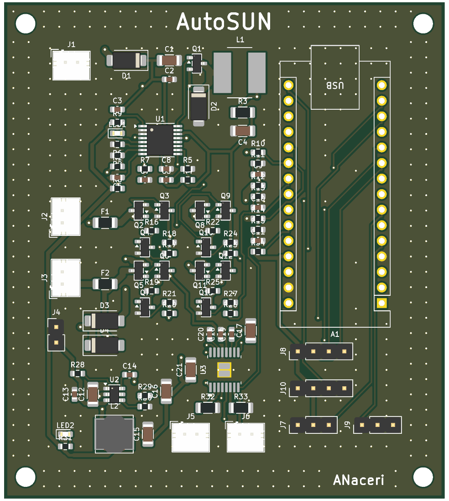

# AutoSun: Solar RC Car Board

One circuit board that runs a small solar-powered RC car. It charges the batteries from solar panels, swaps between two battery packs on its own, drives two rear motors and a steering servo, and holds an Arduino Nano Every as the brain.

## What the board does
- **Solar charging:** 4 small panels, wired as two pairs, charge the batteries, getting as much power from the sun as they can.
- **Two battery packs:** one drives the car while the other charges. The board switches between them automatically.
- **5 V supply:** powers the Arduino, the servo and the sensors. It stays on during a battery swap, so the Arduino never restarts.
- **Motor driver:** runs the left and right rear motors, with a built-in current limit so they can't be overloaded.
- **Plug-in spots:** steering servo, ultrasonic distance sensor, IR remote receiver, and a spare I2C port.
- **Plugs:** JST-PH 2.0 for the solar panels, both battery packs and both motors.

## Folders
| Where | What's in it |
|---|---|
| `solar_car.kicad_pro` | The KiCad 10 project. Open this to see the circuit and the board. |
| `builds/A_full_assembly/` | **Version A, ready to order:** the factory builds and solders everything except the Arduino and pin headers. Upload `gerbers_upload_this.zip`, `BOM_JLCPCB.csv` and `CPL_JLCPCB.csv`. |
| `builds/B_own_modules/` | **Version B, ready to order:** same board, but it uses my own red DRV8833 motor module and MP1584 5 V module instead of factory-soldered chips. Cheaper, with a bit more soldering. Same 3 files to upload. Its KiCad project is in `kicad/`. |

Both folders have `YOU_SOLDER_THESE.csv` listing what you solder yourself. For version B, set the MP1584 to 5.0 V with a multimeter **before** wiring it in.
| `sim/` | An LTspice test of the battery swap. The swap needs at least a 1 ms pause between packs; the code will use 5 ms. |
| `schematic_preview.png` | A quick picture of the circuit. |

## Open it
Install [KiCad 10](https://www.kicad.org/), then open `solar_car.kicad_pro`. In the board view, press `Alt+3` for 3D.

## Status
The board is fully laid out, passes KiCad's design checks, and every part has a JLCPCB part number. **Not ordered yet.**

Next up: write the Arduino code (driving, battery swap, IR remote, and self-driving with the ultrasonic sensor).
