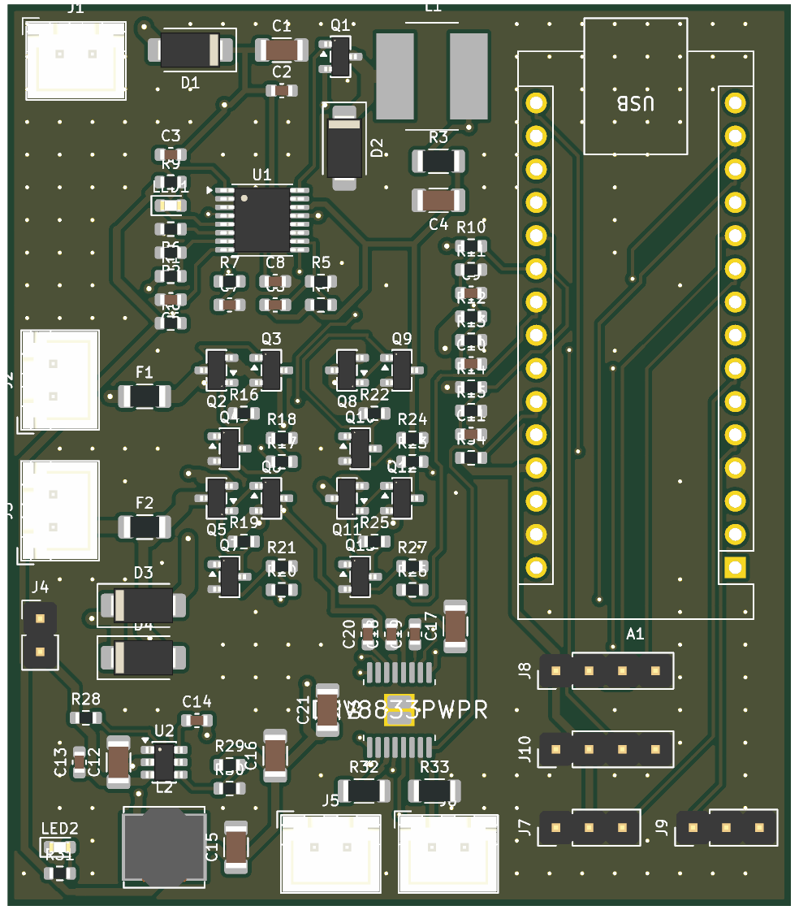

# AutoSun: Solar RC Car Board

One circuit board that runs a small solar-powered RC car. It charges the batteries from solar panels, swaps between two battery packs on its own, drives two rear motors and a steering servo, and holds an Arduino Nano Every as the brain.

## What the board does
- **Solar charging:** 3 small panels in series charge the batteries, getting as much power from the sun as it can.
- **Two battery packs:** one drives the car while the other charges. The board switches between them automatically.
- **5 V supply:** powers the Arduino, the servo and the sensors. It stays on during a battery swap, so the Arduino never restarts.
- **Motor driver:** runs the left and right rear motors, with a built-in current limit so they can't be overloaded.
- **Plug-in spots:** steering servo, ultrasonic distance sensor, IR remote receiver, and a spare I2C port.

## Folders
| Where | What's in it |
|---|---|
| `solar_car.kicad_pro` | The KiCad 10 project. Open this to see the circuit and the board. |
| `fab/` | Files to send to JLCPCB: the board zip, the parts list (BOM) and the part positions (CPL). |
| `sim/` | An LTspice test of the battery swap. The swap needs at least a 1 ms pause between packs; the code will use 5 ms. |
| `schematic_preview.png` | A quick picture of the circuit. |
| `hand_solder_parts.csv` | Parts you solder yourself: the Arduino and the pin headers. |

## Open it
Install [KiCad 10](https://www.kicad.org/), then open `solar_car.kicad_pro`. In the board view, press `Alt+3` for 3D.

## Status
The board is fully laid out and passes KiCad's design checks. **Not ordered yet.**

Still to do:
- [ ] Final board size and mounting holes (waiting on the car's dimensions)
- [ ] Match part numbers in JLCPCB's parts tool
- [ ] Decide on the charger coil size (22 µH or 33 µH)
- [ ] Double-check one small charger capacitor (C5)
- [ ] Write the Arduino code
- [ ] Get a second battery protection board (BMS)
