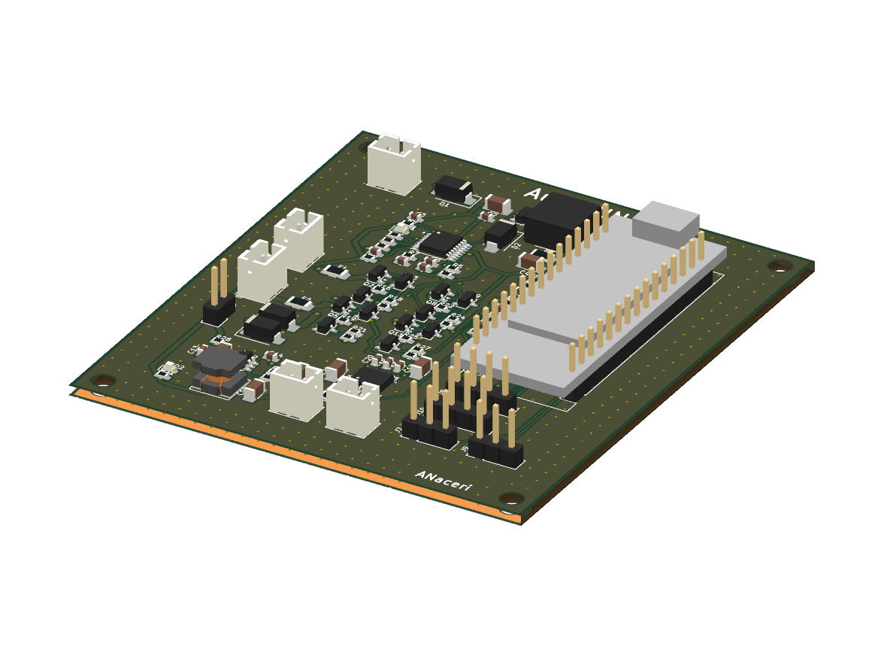

# AutoSUN board: files for the car body (CAD)

Two board versions. Both are the **same size, shape and hole positions**; only the parts on top differ.

## Files to send
| File | What it is | Opens in |
|---|---|---|
| **`AutoSUN_A_simple.step`** | **Start here.** Simple 3D model of version A: one part (board with holes + plain blocks for every part, real sizes and heights) | SolidWorks, Fusion 360, Inventor, FreeCAD, AutoCAD |
| **`AutoSUN_B_simple.step`** | Same for version B | Same |
| `AutoSUN_A_detailed_assembly.step` / `..._B_...` | Detailed version, opens as an assembly of ~90 small parts. Only needed for a realistic render. | Same |
| `AutoSUN_A_outline.dxf` | Flat 2D drawing: outline, 4 holes, plug locations | AutoCAD and any 2D CAD |
| `AutoSUN_B_outline.dxf` | Same for version B (adds the motor module and 5 V module spots) | Same |

All files are in **millimetres**. The origin (0, 0) is the **bottom-left corner** of the board, with the Arduino's USB plug facing the top edge.

## Board size (both versions)
- **72 × 81 mm**, **1.6 mm thick**, square corners
- **4 mounting holes:** 3.2 mm diameter (fits M3 screws), centred **3.5 mm in from each edge**
  - Hole centres: (3.5, 3.5), (68.5, 3.5), (3.5, 77.5), (68.5, 77.5)
  - Hole-to-hole spacing: **65 mm** across × **74 mm** up
  - Keep about 7 mm around each hole clear for the screw head or standoff

## Heights
| Where | Height |
|---|---|
| Board itself | 1.6 mm |
| Above the board (tallest) | **~9 mm**: the pin headers (servo, sensor, switch plugs) and the Arduino's pins |
| Arduino Nano Every (top of its USB plug) | ~7 mm |
| White battery/solar/motor plugs (J1, J2, J3, J5, J6) | ~6 mm, plus ~5 mm more once a cable is plugged in |
| Version B motor module (U4), raised on its pins | module ~5 mm, its pins ~9 mm |
| **Below the board** | solder pins stick out **~3 mm**, so use **standoffs of 5 mm or more** |
| Room for cables plugged into the top pin headers | leave **~15 mm** above the board |

Version B also has a loose **MP1584 5 V module (22 × 17 × 4 mm)**. It's wired to pads on the board, so it can be taped down on the board or mounted nearby.

## Plug locations (centre of pin 1, from the bottom-left corner)
| Plug | x, y (mm) | Notes |
|---|---|---|
| J1 Solar in | 10.0, 71.2 | Top-left |
| J2 Battery A | 9.5, 45.0 | Left edge |
| J3 Battery B | 9.5, 35.0 | Left edge |
| J4 On/off switch | 8.5, 28.0 | Left edge, wires to a toggle switch |
| J5 Left motor | 29.5, 10.5 | Bottom edge |
| J6 Right motor | 38.5, 10.5 | Bottom edge |
| J7 Servo | 48.0, 12.0 | Bottom-right |
| J8 Ultrasonic sensor | 48.0, 24.0 | Bottom-right |
| J9 IR receiver | 58.5, 12.0 | Bottom-right |
| J10 Spare I2C | 48.0, 18.0 | Bottom-right |
| Arduino USB opening | centre ≈ 54.1, 70.9 | Plug goes in from the top edge; leave a cut-out for the cable |
